# Architecture

Read [AGENTS.md](../AGENTS.md) first. This document explains the design; it is not a tutorial
for users (see [README.md](../README.md)). When this document and the code disagree, the code
and the tests are right; fix this document.

## The three layers

1. **Local sync.** A conversation has one canonical source on disk (an omp/Pi journal, a
   Claude transcript, an Antigravity conversation database, or an OpenCode database row). The daemon detects changes, converts the
   canonical session into each *chosen* harness, and writes mirrors. Mirrors are derived data.
   A lock makes sure only one harness writes a conversation at a time.
2. **Team sync (client).** A user *marks* a session. After it has been quiet, the daemon builds
   the canonical omp/Pi journal for it, takes a server lease, seals the journal to the team's
   devices, signs the record, and pushes it. A pull lists the team's conversations, fetches
   records, and accepts only those that pass every check. Import (writing a pulled session into
   a local harness) is always a confirmed, separate action.
3. **Team server.** Stores opaque sealed records, issued tokens, leases and the admin-signed
   member list. It enforces write authorization and one-writer-at-a-time, but it never holds a
   key that can open a session and never parses plaintext.

```
harness stores ── scan ──> State ── mirror_write ──> other harness stores
                              │
                              │ marked + quiet + canonical
                              v
                       lease acquire ──> seal ──> POST /record/sealed ──> team-server
                                                                             │
                       TUI / daemon pull <── verify <── POST /record/sealed/read
```

## How the main logic works

X, Y and Z stand for any harness. The logic below is the same for every one of them; what
differs per harness is only *how* a copy is read and written:

- **Storage:** one file per conversation (written to a temp file, then renamed into place), or
  a database behind the harness's own CLI (imported, after the import is proven in a throwaway
  store).
- **Identity:** an id in the file name, the file stem, or a row id; sesync keeps whatever id
  a copy already has.
- **Workspace:** the folder or project bucket a harness lists a conversation under, derived from
  the conversation's working directory.
- **Title:** a slot in the file, an appended record, a side file, or a store column.
- **Locking:** a harness with a hook claims its turn; one without relies on the write refusal
  ("in use") and the archive.

### One conversation, one source, copies where the user chose

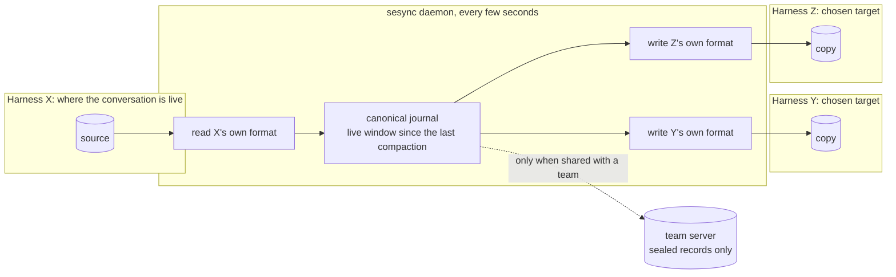

Nothing is written to a harness the user did not choose for that conversation, and a copy is
never treated as a source of its own.

### One daemon pass

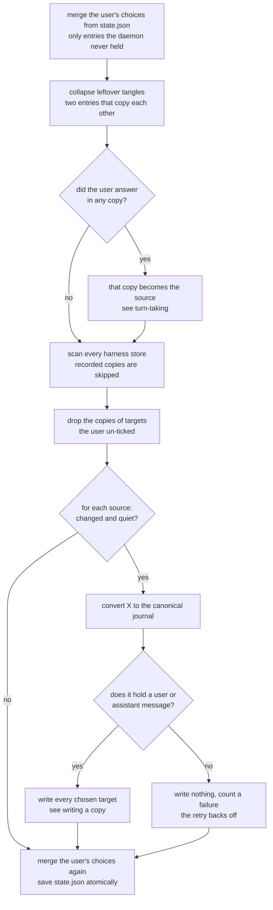

### Writing a copy into Y

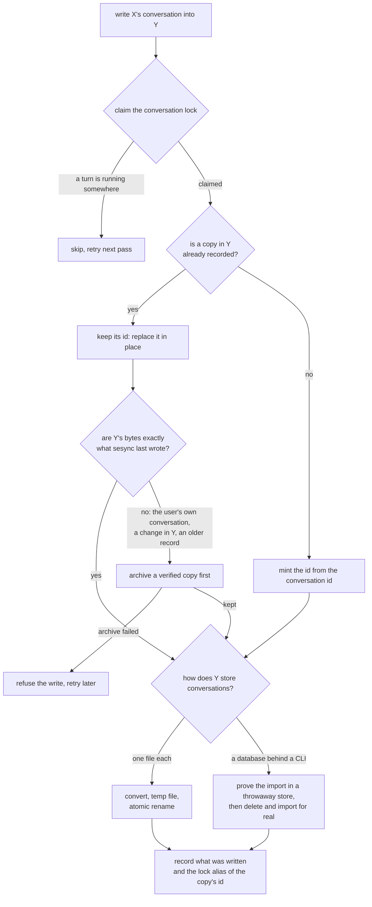

### Turn-taking: the user answers in a copy

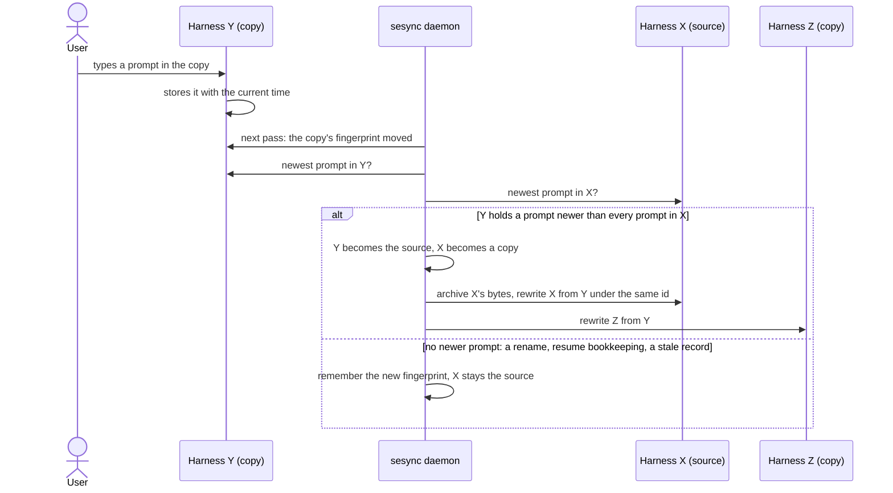

Every copy sesync writes carries the source's own timestamps, so a copy can only get ahead of
its source by somebody typing into it. When several copies were answered, the newest prompt
wins.

### The life of a copy

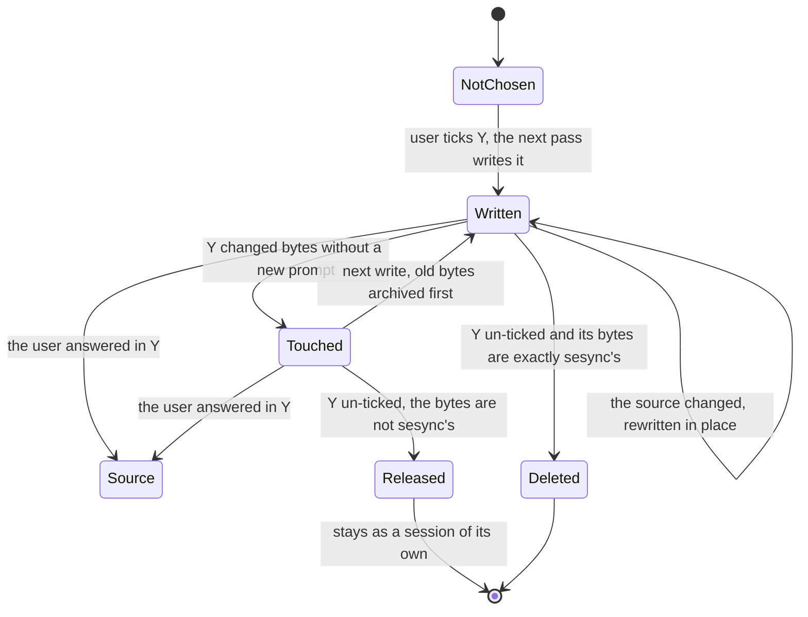

### One lock per conversation, whichever copy is live

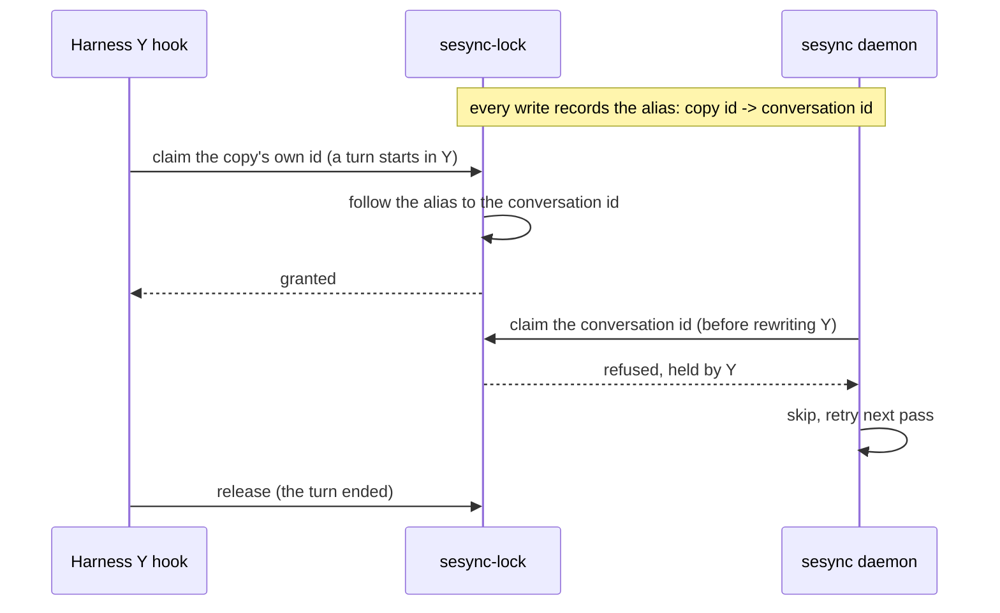

### Sharing with a team

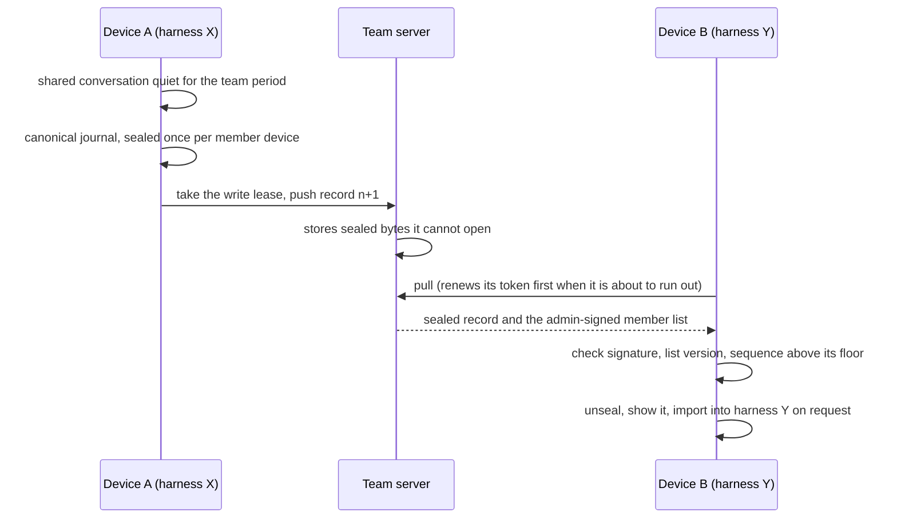

### Team membership and revocation

This is the contract for who is in a team. It changes in the same change as the code that
implements it (AGENTS.md rule).

- **The admin-signed list is the roster, and only explicit admin decisions change it.** Every new
  version is built on the admin's machine from the last list it verified, plus devices it
  approves and minus devices it revokes. Nothing joins by being enrolled.
- **The team code proves that someone was given the authenticator, nothing more.** With it a
  device can ask to join and re-authenticate its own listed key. A new key always waits for the
  admin; a listed machine's key is never replaced through a join; a revoked key and a removed
  member are refused at the door. So nobody re-scans a QR when someone leaves.
- **A join is signed by the key it presents.** The device signs the space, member, machine, code
  and its entry with its own private key, so knowing a listed machine's name and public keys
  (every listed device sees them) gets nobody a token for that machine.
- **The roster stays inside the team.** Member and machine names, pending requests and
  fingerprints are admin-only. A listed device fetches only the signed key list it needs to seal
  and verify. A pending or revoked device gets no list, no conversation ids and no records.

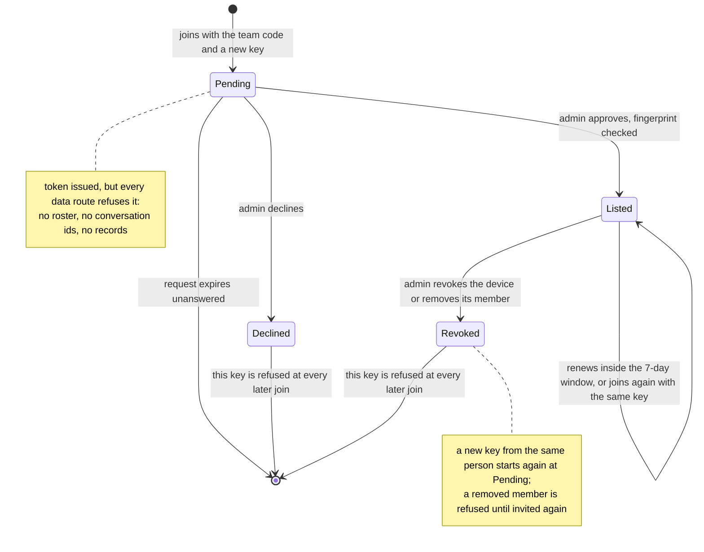

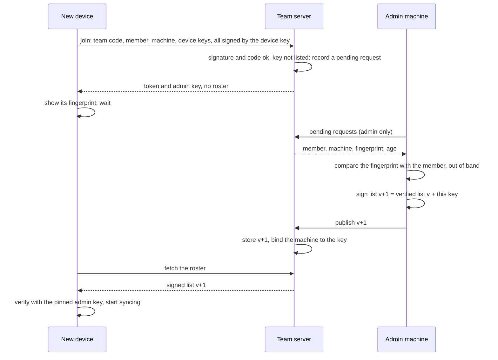

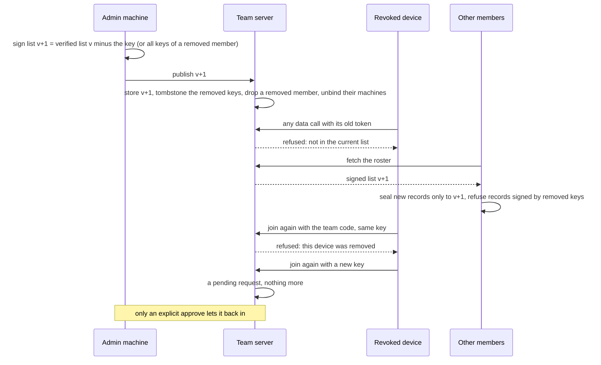

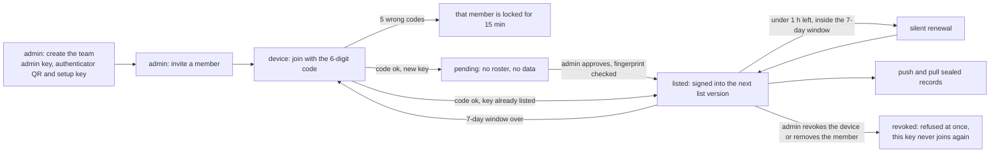

## Harnesses

Everything sesync knows about one harness lives in its module under `sesync/src/harness/`,
behind the `Harness` trait. The rest of sesync (the scan, turn-taking, mirror writes and
cleanup, the team push, the TUI) asks the registry (`harness::ALL`, `harness::get`) and never
names a harness: outside `harness/`, no production code contains a harness id.

| Module | Harness | Kind | Store (default; override) |
|---|---|---|---|
| `omp.rs` | omp | files | `~/.omp/agent/sessions/<bucket>/<ts>_<uuid>.jsonl`; `OMP_AGENT_DIR` |
| `pi.rs` | Pi | files | `~/.pi/agent/sessions/<bucket>/<ts>_<uuid>.jsonl`; `PI_AGENT_DIR` |
| `claude/` | Claude Code | files | `~/.claude/projects/<bucket>/<uuid>.jsonl`; `CLAUDE_CONFIG_DIR` |
| `opencode/` | OpenCode | store | `~/.local/share/opencode/opencode.db`, read-only, and the `opencode` CLI; `OPENCODE_DB`, `OPENCODE_BIN` |
| `antigravity/` | Antigravity (`agy`) | files | `~/.gemini/antigravity-cli/conversations/<id>.db` plus its WAL; `ANTIGRAVITY_CLI_HOME`, `AGY_BIN` |
| `journal.rs` | shared | | JSONL helpers for omp, Pi and Claude: file names, listing, windowed titles, prompt times, install through `sesync-conv to-<id>` |
| `retired.rs` | Gemini CLI | retired | released at load, never deleted |

The trait, by what sesync does with a harness:

| Need | Methods |
|---|---|
| Name it | `id`, `label` (sessions list, at most 8 cells), `icon` (picker), `kind` |
| Find it | `locate` (its own environment variables), `present` (offered as a target) |
| List and read files | `sessions_dir`, `sessions`, `subagents`, `files_of` and `side_files` (a conversation of several files), `title`, `title_stamp`, `cwd`, `placed_by_cwd` and `misplaced` |
| List and read a database | `rows`, `row_title`, `fingerprint`, `export`, `remove` |
| Move a conversation | `to_journal`, `install`, `mirror_id`, `id_in`, `copy_exists` |
| Follow the user | `newest_prompt` (turn-taking), `rename` |

Every conversation crosses harnesses as one canonical journal (the omp/Pi format):
`to_journal` makes it from the source (`sesync-conv from-<id>`, or nothing when the source
already is one), and `install` writes it into each chosen target (`sesync-conv to-<id>`). The
same journal is what the team push seals.

**Adding a harness**, once `sesync-conv` converts it: write `harness/<id>.rs` (or
`harness/<id>/` when it carries its own store or CLI code) implementing `Harness`, declare it in
`harness/mod.rs`, and list it in `ALL` (the picker's order). **Removing one**: delete its module
and its `ALL` entry, and add a `Retired` entry to `harness::RETIRED`; the next load releases its
records (see "Retired harness" below). Both were checked on 2026-10-21 against a copy of the
crate: with `harness/opencode/` deleted and a throwaway `dummy` harness added (Pi's layout under
`~/.dummy`: one new file and two changed lines in `harness/mod.rs`), the library and the daemon
compiled with no other change, and a `--once` pass mirrored an omp session into `~/.dummy` and
recorded the copy and its sync time.

## Local sync

- Each file harness lists its conversations (`Harness::sessions`) and each database harness its
  rows (`Harness::rows`, one read per pass). `scan` decides whether a source changed and is
  quiet enough (`SESYNC_QUIET`, default 20 s; `MIN_BYTES`; `SESYNC_MAX_AGE_DAYS`, default 14).
- A chosen mirror target with no mirror forces a pass. When a write keeps failing (an empty
  stub session, a conversion error), retries back off (`scan::mirror_demand`,
  `scan::mirror_retry_due`): the quiet period after the first failure, doubling to a 10-minute
  cap; a changed file and a successful pass reset it. The TUI shows a chosen target with no
  file as `pi?` (pending) or `pi!` (failing) in the MIRRORS column.
- Mirror **placement** follows the source session's own project directory, not the target
  store's layout: omp buckets are home-relative (`-SkillsOutlie` for `~/SkillsOutlie`) and are
  computed from the real home (`Env.home`, not the store's parent); Pi and Claude buckets are
  separator-replaced absolute paths. The cwd is read from the source's head (`Harness::cwd`,
  `journal::cwd_from_head`). A recorded mirror is stale (`scan::mirror_stale`) when the target
  says it is misplaced (`Harness::misplaced`: its bucket disagrees with that cwd), the file is
  gone, or, for a database harness, its id is absent from the rows the scan read; the next pass
  rewrites it, and `mirror_write::record_mirror` replaces the
  record, deleting the superseded file only when it is unchanged.
- A source's identity is `(fmt, key)`. omp and Pi both use the journal format; their `key` is
  the session id. OpenCode's `key` is its session id (`ses_...`); its display title is
  recorded in `Source::title` at scan time because the source does not carry one on disk.
- `mirror_write` is the only writer. It claims the conversation lock (`with_claim`), then hands
  the canonical journal to the target's `Harness::install` (omp, Pi and Claude through
  `journal::install`, agy through `antigravity::store::install_antigravity`) and records a
  created file in `State::mirror_keys` so the daemon never mistakes a mirror for a source. A
  source that is not a journal is converted first by its own harness (`Harness::to_journal`:
  `sesync-conv from-claude`, `from-antigravity`, an OpenCode export): a raw transcript or
  database must never be copied through to another harness.
- The OpenCode target is an import, not a file: `opencode::store::install_opencode` converts the same
  journal to an import bundle (`sesync-conv to-opencode`) and runs `opencode import` with the
  conversation's directory as the working directory, so the session lands in the right project.
  `opencode import` conflict-ignores existing message ids, so the writer deletes the previous
  mirror id first (`opencode session delete`); the deterministic id
  (`opencode::mirror_opencode_id`) makes that a replace, never a duplicate. The import is not
  atomic (it writes the session row, then stops at the first message it rejects), so the
  bundle is first imported into a throwaway store (`XDG_*` pointed at scratch) and only a
  bundle that imports there may delete and replace the real session. The delete runs in the
  directory the store keeps the session under (`opencode::store::session_directory`), since
  `opencode session delete` only finds a session from inside its own project; the import runs in
  the conversation's own directory, so a copy never stays in a wrong project. The mirror
  record carries the session id instead of a path and a content fingerprint
  (`opencode::store::content_fingerprint`) as its `installed_hash`; the id is not added to
  `mirror_keys` (that set names files, and a session id in it could hide a real OpenCode
  session from the scan).
- **Mirror ids are minted from the conversation's stable id, not from the moving source key**
  (`Source::conv`: the uuid/ses id of the store copy that started the conversation). A
  turn-taking promotion changes the source key; a key-derived id would mint a new copy in
  every other store and leave the old ones behind. A copy already recorded keeps the id it has
  (`mirror_write::recorded_id`), so each store's copy is replaced in place for the
  conversation's lifetime, including the old source a promotion demoted, which keeps the id its
  harness has always known it by.
- **Bytes sesync did not write are never replaced without a verified archive copy**
  (`mirror_write::preserve_foreign`, `archive_store::keep_before_replace`). `installed_hash`
  means "what sesync wrote": a file's sha256, an OpenCode copy's content fingerprint, empty
  when the bytes are not sesync's (the demoted original of a promotion, a record of an older
  binary). Before a write replaces a copy whose current content differs, the bytes (an
  `opencode export` for a store copy) go to `<state>/archive/<conversation>/<name>.<ms>.hsar`,
  read back and compared; if that fails, the write is refused and retried later. A journal with
  no user or assistant message never replaces any copy (`scan::journal_has_messages`).
- **Turn-taking** (`turn.rs`): a mirror is a copy, but the user may answer in the copy's
  harness. An answer is a user prompt in the copy newer than every prompt of the source
  (`Harness::newest_prompt`; sesync's own compaction note and
  command wrappers are not prompts). Every copy sesync writes carries the source's own
  timestamps, so changed bytes alone (a rename, resume bookkeeping, an older write, a state
  record that fell behind) never move the source. Detection costs one stat per recorded mirror
  per pass (`Mirror::edit_stamp`); the prompts are read only when the fingerprint moved, and
  for OpenCode only when the row's `updated` passed `Mirror::target_updated`. The newest answer
  wins (ties break by harness name), the copy becomes the session's source (the main harness
  moves) and the same pass rewrites every other configured copy from it without the quiet
  window. The old source becomes the copy in its own harness with an empty `installed_hash`.
  Leftover tangles (entries recording each other as mirrors) are collapsed to the most recently
  turned entry before any copy is checked, so a stale entry cannot turn the conversation back.
  Resurrection is closed at every merge point: the daemon adopts from disk only keys it never
  held (`State::seen_keys`) that are no copy anywhere (`State::is_recorded_mirror`); the TUI
  prunes sources the daemon removed and its `save_user` adds only entries it created itself
  (`tui_created`); the scan and the session list never treat a recorded copy as a source.
- **One lock per conversation, whichever copy is live.** Every write claims the conversation's
  stable id, and every copy's own session id (and the source's, when it differs) is aliased to
  it in `<locks>/map/<id>` (`lock::write_alias`), which `sesync-lock` follows one hop. A turn
  inside any copy and the daemon's write of that copy contend for the same lock. Aliases are
  written only when the lock binary is present.
- The Antigravity CLI (`agy`, which replaced Gemini CLI on 2026-06-18) keeps one SQLite
  database per conversation, `$ANTIGRAVITY_CLI_HOME/conversations/<id>.db` (default
  `~/.gemini/antigravity-cli`), its title in `annotations/<id>.pbtxt`, and a summary cache
  sesync never writes. `sesync-conv to-antigravity` builds the database aside and publishes it
  atomically as `<id>.db` (the id is `mirror_uuid(conv, "antigravity")`, then the recorded
  stem), replacing an existing copy in place; when agy holds the copy open the converter
  refuses with "in use" and leaves it intact, which is a normal retry. Because the agy harness
  lists the same directory for sources, the mirror path **is** added to `mirror_keys`. agy is in WAL mode:
  a turn typed while agy runs lives in `<id>.db-wal` until agy exits, so one helper
  (`mirror::copy_files`, `copy_hash`, `copy_stamp`, `copy_mtime`, `remove_copy`) makes the
  scan's stamp and hash, turn-taking's fingerprints, `preserve_foreign`'s archive and cleanup
  cover the database and its WAL together. The prompt reader (`antigravity::store::newest_prompt`:
  the newest USER_INPUT step, type 14, timed by StepMetadata field 1) opens the database
  read-only without creating `-wal`/`-shm` next to agy's file (`antigravity::store::read_only`:
  read-only with WAL and index present, `immutable=1` without a WAL, else a scratch copy).
  Titles come from the annotations file, else agy's cached summary title (read only); a TUI
  rename runs `sesync-conv antigravity-retitle`, whose exit 2 means agy shows the name after
  it restarts. Whether agy is installed (the picker offer) is decided by `AGY_BIN`, else
  `%LOCALAPPDATA%\agy\bin\agy.exe`, else `agy` on PATH; sesync never runs agy.
- **Retired harness: Gemini CLI.** `State::retire_harness` runs for every `harness::RETIRED` entry at every
  load and merge (daemon, `sesync mirrors`, TUI reloads). A Gemini source is re-keyed to its
  best surviving copy (in `harness::ALL` order: omp, Pi, Claude, OpenCode, Antigravity; the copy must
  exist and not already be a source), keeping its conversation id, title and shares; its
  chosen targets lose `gemini` and the new format, its mirrors lose the new format's record.
  With no surviving copy the entry is dropped. Every other source releases `gemini` from its
  choices and mirrors, and `mirror_keys` forgets Gemini paths. No Gemini file is ever touched.
- **`Source::chosen_targets` is the complete write policy.** Empty (the default) means the
  daemon writes nowhere. The TUI picker sets it per session; it never offers the session's own
  format, and it only offers harnesses installed on the machine.
- Mirrors are rebuilt when the canonical source changes; a locked conversation is skipped, not
  queued. Un-choosing a target deletes the copy only when it provably holds what sesync wrote
  (file hash, OpenCode fingerprint) and its source is present; otherwise the record is released
  and the copy stays, as a session of its own.

## Team lifecycle

- **Create** (`sesync team create`): generates the admin Ed25519 key (kept on the operator's
  machine at `<config>/admin/device.key`, mode 0600), creates the space, signs member list v1
  (the admin key alone), and prints a one-time TOTP URI. The admin private key never goes to the
  server.
- **Join** (`sesync team join`, the TUI's "Join a team"): the member proves the TOTP and sends its
  device's public keys with the device's signature over `membership::enrol_message` (space,
  member, machine, code, entry; length-prefixed). Once the team has an admin key, `/enrol`
  checks that signature against the entry's own signing key before the code: no signature is
  400, a signature that does not verify is 403 with no token, and neither spends the code or
  counts as a wrong attempt (`http::enrol`). Nothing about the machine is stored before the code
  is confirmed. Then, by the key: a revoked or declined key gets 403 "this device was removed from
  the team" and no token; a key in the current list bound to this machine for this member is
  re-authenticated (200, token, admin key and signed list), and a listed key no machine holds yet
  is bound to this machine the same way; a listed key bound to another machine (or member)
  gets 409; a new key under a machine name bound to a listed key gets 409 "machine name already
  in the team" and nothing changes, so the real device keeps working; any other new key records
  or refreshes a join request (member, machine, entry, time; at most 3 per member and 20 per team,
  429 beyond; expires after 7 days) and gets 202 `status: pending` with a token, the admin key and
  the device fingerprint, and no list. A pending machine is never bound, so every member route
  refuses its token. The credential (under `~/.config/sesync` or `SESYNC_CONFIG_DIR`) holds the
  token, the machine id, the server it was joined on and the pinned admin public key, plus the
  signed list once the device is listed. That pinned key is the trust root: it is the only thing
  that can widen who this device accepts. Five wrong codes lock joining for 15 minutes, both on
  the machine and for the member whatever machine name the next attempt uses.
- **Waiting** (`team_join::check_approval`): a credential with an admin key and no list waits.
  The daemon's team step and the TUI's pull ask `/list`; 403 means still waiting (the daemon logs
  "waiting for the admin to approve <machine> (fingerprint ...)" once per team per run); 200 is
  the admin's approval, and the list, verified with the pinned admin key, is stored and the team
  syncs from the same step. A token that ran out while waiting is renewed first.
- **Roster** (`sesync team roster`): `/admin/roster` returns the signed list and its version, the
  member and machine bound to each listed key, and the open requests with their entries; the CLI
  verifies the list with the admin key on this machine and shows fingerprints it computes itself.
- **Approve, revoke, remove** (`sesync team approve|revoke|remove`): each builds list v+1 from
  the list v the CLI just fetched and verified with its own admin key (never from what devices
  sent at join), signs it on the admin machine and posts it to `/admin/list`. Approve adds the
  requested key, after checking `--fingerprint` when given (a mismatch signs nothing); revoke
  drops one machine's key; remove drops every key of a member and names the member in
  `removed_members`. The admin's own key is never dropped. Storing the list applies it: a key it
  drops is tombstoned and its machine unbound (the token is refused at once, the key never joins
  again), a key it adds binds the machine that asked for it, and a removed member leaves the
  member set, so `join` refuses them until `invite` adds them again. Revocation narrows the
  recipient set on the next seal.
- **Decline** (`sesync team decline`): `/admin/decline` drops the request and tombstones its key.
- **Renew** (`sesync team renew`): renews a token while the enrolment is inside its window and
  the device is listed; after that the TOTP is needed again, and that code-confirmed join starts
  a new 7-day window. The daemon (each team step) and the TUI (before a manual pull) renew any
  token that runs out within an hour, so a team keeps syncing past its first day without a
  manual renew.
- **Upgrade of an existing team**: the first membership action on a team with a trust root
  (join, roster, decline, a list change) turns every machine binding whose key the current list
  does not name into a join request dated then, not a tombstone; bindings to listed keys stay. No
  member re-scans anything. A team created without an admin key (no trust root) keeps the legacy
  rule: the code alone admits, with no requests, approvals or tombstones.

Membership levels: the server's admin token authorizes `/admin/*`; a device token
(machine-scoped) authorizes member routes only while the machine is bound to a key the current
signed list names. A write also needs the record signed by a device the current list names.

## Push path (exactly what runs)

1. `State::marked` holds the sessions the user marked. Nothing else is eligible.
2. `team_sync::is_due` requires the source to be quiet for `SESYNC_TEAM_QUIET` (default
   120 s) and the plaintext hash to differ from the last successful push.
3. `team_sync::canonical_for_source` produces the team copy: the omp/Pi journal as-is for
   omp/Pi sources, `sesync-conv from-claude` for Claude, `from-antigravity` for Antigravity, and
   `opencode export` + `sesync-conv from-opencode` for OpenCode. Reasoning is kept only where
   the converter can carry it as ordinary text; signed Claude thinking is dropped.
4. `team_push` acquires the lease. **The lease version is the record sequence.**
5. `sealed::seal_for_devices` compresses, encrypts, wraps the key to every listed device,
   and signs a v2 record bound to `(space, conversation, sequence)`.
6. `HttpTeam::put` posts to `/record/sealed?space&conversation&machine&version`. The server
   checks the token, the exact lease version, the signature, the author's place in the
   current list and the record's sequence equal to that version, then stores the bytes.
7. On success the daemon records `{hash, pushed_at}` in `State::team`. Sealing is randomized,
   so the change check must never hash sealed bytes (there is a regression test for this).

## Pull path (exactly what runs)

1. `POST /sessions` returns conversation ids and, when the stored bytes carry one, each
   conversation's current record sequence. That number is advisory only: it can save a fetch,
   never authorize an accept.
2. The client skips a fetch only when it has a persisted floor and the advertised sequence is
   not above it. No floor, or no advertised number, means fetch.
3. `POST /record/sealed/read` returns the stored record bytes.
4. `open_record` checks, in order: v2 magic, parse, expected space, expected conversation,
   list version not below the reader's verified list, author listed in that list, signature,
   and sequence at or above the reader's floor. A failure is counted and dropped; it is never
   shown.
5. `team_pull_verified` merges accepted sequences upward into `State::team_seen`. The floor
   only ever rises. A record below it is a rollback and stays refused.
6. The daemon only displays what passed. Writing a pulled session into a harness is an
   explicit user action (`team_import`, an `i` key press from the TUI).

## Trust model

What the server can do: refuse writes, withhold records, return an old record, or lie about
the sequence list. What it cannot do: read or forge a session, add a device to the list, make
a client accept an author that the pinned list does not name, or roll a client below its
floor. The pinned admin key is the root; the server merely stores the admin's signature.
Every use re-verifies the list: `Trust::verifier()` parses and checks the signature before
any seal or open, so a fetched list can only narrow or widen within what the admin signed.

The client trusts the *newest* verified list it has seen (`fetch_and_verify` refuses a lower
version). A writer whose list is behind the server's will have its record refused: it must
refresh before sealing. This is deliberate, so a device cannot seal under a list that already
revoked someone.

Admission. The team code is a shared secret, so the server never admits on it: a code holder can
ask to join and re-authenticate a key the admin already listed, nothing more. A new key waits as a
request until the admin's CLI signs it into the next list; a listed machine's key cannot be
swapped through a join; a revoked or declined key is tombstoned and refused at every join. Names,
machines, requests and fingerprints are served only on `/admin/roster`; a member fetches only the
signed key list on `/list`, and a pending or revoked device gets no list, no conversation ids and
no records. The admin CLI builds every new list from the list it verified with its own key, so a
server that lied in the roster could at worst hide a request or misname a machine: it cannot add
a key, and the CLI refuses to drop the admin's own key whatever name the server gives it. A join
must be signed by the private key of the entry it presents, so a code holder who copies a listed
device's public entry gets 403 and no token; one who presents a key of their own under a listed
machine's name gets 409. A captured join is worthless once its code is spent, and the code is
one-use per machine.

## Wire formats

### Record v2 (`sesync-team/src/signed_records.rs`)

```
"SR2" | author(32) | list_version(8) | sequence(8)
      | space_len(2) | space | conv_len(2) | conversation
      | sig(64) | content
```

All integers big-endian. `sig` is Ed25519 over every byte except the 64 signature bytes.
`sequence` is the lease version. A record that does not start with `SR2` is refused as
`UnsupportedFormat`; v1 is not converted. There is no production v1 data.

### Record content (`sesync/src/sealed.rs`)

```
u32 wrap_count | { u32 device_len, device(32), u32 sealed_len, sealed } * wrap_count | body
body = codec(1) | data
codec 0x00 = stored, 0x01 = zstd
```

Wraps are `crypto_box` sealed boxes: the per-record random data key, sealed to each listed
device's X25519 box key. The body is ChaCha20-Poly1305 with associated data

```
u64 space_len | space | u64 conv_len | conversation | u64 sequence
```

so a body cannot be moved to another space, conversation or sequence even inside a valid
signature. Max session size: 64 MiB before compression and after decompression; decompression
is chunked with a bounded window, so a crafted record cannot exhaust memory. zstd level 3;
if compression does not shrink the session, the codec byte says stored.

### Member list (`sesync-team/src/membership.rs`)

The admin signs a versioned list of device entries, each a device's Ed25519 signing key and
X25519 box key (64 bytes); it names no member or machine (those stay server-side, admin-only).
The server refuses a list version that does not increase. Clients verify the signature against
the pinned admin key on every use. See the module for the exact encoding. A device's fingerprint
is the first 8 bytes of SHA-256 over its entry, as hex in four groups of four
(`membership::fingerprint`, e.g. `a1b2-c3d4-e5f6-a7b8`), shown alike by the server, CLI and TUI.

## Persistence

Client state (`<SESYNC_DIR>/state.json`, default `~/.local/share/sesync/state.json`):

| Key | Meaning |
|---|---|
| `sources` | per `(fmt,key)`: `conv`, `last_seen_change`, `last_hash`, `last_stamp`, `failures`, `last_failure`, `mirrors`, `chosen_targets`, `title`, `turn_at` |
| `sources[].sync` | per chosen copy: `{ok_at, problem, problem_at}`, the daemon's last good write and last failure. Settled on every pass (`settle_sync_records`): a copy no longer chosen loses its record at once, and a file copy written before the record existed gets `ok_at` once from its mtime (never for a diverged copy or bytes sesync did not write; an OpenCode copy waits for its next write, since its row time is the imported conversation's). A problem that says "will retry" (the copy was in use) shows as waiting, not failing |
| `mirror_keys` | every path/id the daemon created; never treated as a source |
| `subagents` | parent session → subagent transcript paths |
| `marked` | sessions eligible for team push |
| `team` | per session: `{hash, pushed_at}` of the last successful push |
| `team_seen` | per conversation: highest accepted team sequence (rollback floor) |

A missing state file is empty state; a corrupt one is an error (silently dropping it would
forget every mirror and risk duplicate writes).

Credentials and keys. The CLI, the TUI and the daemon all use the same config dir:
`SESYNC_CONFIG_DIR`, default `~/.config/sesync`. A credential written by `team join` is
therefore visible to the daemon without any copying.

| Path | Contents |
|---|---|
| `~/.config/sesync/teams/<space>.cred` | token, member, machine, server, pinned admin key, signed list, list version (no list while the join waits for the admin); mode 0600. A team name holding `/ \ : * ? " < > \|`, `%`, a control character, a leading dot or a trailing dot or space has those characters percent-encoded in the file name |
| `~/.config/sesync/device.key` | this machine's device Ed25519 + X25519 keys; mode 0600 |
| `~/.config/sesync/admin/device.key` | admin key, only on the operator's machine |
| `~/.config/sesync/admin/teams.json` | the teams started from this machine: `[{team, server, token_file}]` (the token file's path, never the token), so the TUI's admin dialogs work there without environment variables |

Server store (`sesync-team/src/pg.rs`), one schema per deployment:

| Table | Purpose |
|---|---|
| `spaces` | wrapped space key |
| `records` | `(space, conversation) → signed record bytes` (opaque) |
| `trust` | current admin-signed member list |
| `admin_keys` | the admin public key pinned at create |
| `devices` | machine bindings: the listed key each machine joined with or was approved for |
| `requests` | open join requests: `(space, machine) → member, entry, requested_at` |
| `tombstones` | revoked and declined keys per space, refused at every join |
| `enrolled` | enrolment timestamps |
| `gates` | per-machine authenticator code state (used codes, lockout) |
| `owners` | the member each bound machine belongs to |
| `backups` | per-space backup policy |

## HTTP routes (`sesync-team/src/server.rs`)

| Route | Auth | Purpose |
|---|---|---|
| `GET /healthz` | none | liveness |
| `GET /metrics` | none | counters |
| `POST /admin/team` | admin token | create a space; returns the TOTP URI |
| `POST /admin/invite` | admin token | invite a member |
| `POST /enrol` | TOTP, and once the team has an admin key the device's signature (`proof`) over `membership::enrol_message` | join: 200 with token, admin key and signed list for a listed key; 202 `pending` with token, admin key and fingerprint (no list) for a new key; 400 without a signature, 403 when it does not verify (checked before the code); 403 for a revoked/declined key; 409 for a listed machine name or key; 429 beyond the request limits |
| `POST /renew` | token | renew a token inside its window (listed devices only) |
| `POST /lease/acquire`, `/lease/release` | member token | one writer per conversation |
| `POST /sessions` | member token | conversation ids + advisory record sequences |
| `POST /list` | member token | current admin-signed list (key entries only, no names) |
| `POST /admin/list` | admin token | store a newer signed list `{space, signed_list, removed_members?}`; dropped keys are tombstoned and unbound, added keys bind their requests, removed members leave the member set |
| `POST /admin/roster` | admin token | `{version, signed_list, listed: [{member, machine, fingerprint, entry}], pending: [{member, machine, fingerprint, entry, requested_at, age_secs}]}` |
| `POST /admin/decline` | admin token | `{space, member, machine}`: drop the request and tombstone its key |
| `POST /record/sealed`, `/record/sealed/read` | member token | the live sealed push/pull |
| `POST /record`, `/record/read` | member token | legacy plaintext routes, still used by old tests only |

## Environment variables

| Variable | Default | Meaning |
|---|---|---|
| `SESYNC_DIR` | `~/.local/share/sesync` | sync state and archives |
| `SESYNC_LOCK_DIR` | `~/.local/share/harness-sync/locks` | lock files |
| `OMP_AGENT_DIR` | `~/.omp/agent` | omp source |
| `PI_AGENT_DIR` | `~/.pi/agent` | Pi source |
| `CLAUDE_CONFIG_DIR` | `~/.claude` | Claude source |
| `ANTIGRAVITY_CLI_HOME` | `~/.gemini/antigravity-cli` | Antigravity CLI store: conversation sources and mirror target |
| `AGY_BIN` | `%LOCALAPPDATA%\agy\bin\agy.exe` (Windows, when present), else `agy` on PATH | only decides whether Antigravity is offered as a target; never run |
| `OPENCODE_DB` | `~/.local/share/opencode/opencode.db` | OpenCode source |
| `OPENCODE_BIN` | `opencode` | OpenCode CLI used for export (source) and import (mirror target) |
| `SESYNC_CONV` | beside the binary, else `~/.local/bin/sesync-conv` | converter |
| `SESYNC_LOCK` | beside the binary, else `~/.local/bin/sesync-lock` | lock binary |
| `SESYNC_QUIET` | `20` | local quiet seconds before a mirror is rebuilt |
| `SESYNC_MAX_AGE_DAYS` | `14` | ignore sources older than this |
| `SESYNC_POLL` | `5` | daemon tick and base team interval |
| `SESYNC_PASSES` | unlimited | run N passes then exit (testing) |
| `SESYNC_MACHINE` | hostname | machine id for joining |
| `SESYNC_CONFIG_DIR` | `~/.config/sesync` | team credentials, device key and admin key (CLI, TUI, daemon) |
| `SESYNC_TEAM_URL` | unset | team server base URL for a credential that predates recording its server, and for a team configured only by the environment; a joined credential uses the server it was joined on |
| `SESYNC_TEAM_TOKEN`, `SESYNC_TEAM_MACHINE`, `SESYNC_TEAM_SPACE` | from credential | optional overrides |
| `SESYNC_TEAM_QUIET` | `120` | team quiet seconds before a push is due |
| `SESYNC_TEAM_POLL_MAX` | `60` | cap for the team poll backoff |
| `SESYNC_ADMIN_TOKEN_FILE` | unset | admin token for `sesync team` commands |
| `HS_TEAM_URL`, `HS_TEAM_TOKEN`, `HS_TEAM_MACHINE` | unset | TUI remote view (legacy names) |
| `HS_E2E`, `HS_REQUIRE_CLAUDE` | unset | opt-in real-CLI tests |

Unknown or malformed values fall back to the default; a bad env var must never panic the
daemon.

## Failure behaviour

| Situation | What happens |
|---|---|
| Another machine holds the lease | push fails, the session stays marked; retried after the quiet rule |
| Record sealed under an older list than the server's | server refuses (403); the client must `fetch_and_verify` and re-seal |
| Sequence below the reader's floor | dropped and counted as rolled back; never shown |
| Author not in the current list | dropped and counted; never shown |
| Record arrives for another space/conversation | refused before decryption |
| Session > 64 MiB | refused on seal and on open |
| Conversation locked locally | local mirror write skipped this pass |
| Team server unreachable | team step reports the error; local sync continues |
| Corrupt state file | daemon reports an error; it does not silently reset state |
| Mirror target removed | no new writes there; `mirror_cleanup` can remove what was written |
| Join with a new key | 202 pending; the device waits, its token opens nothing; daemon logs the wait once per run |
| Join with a revoked or declined key | 403 "this device was removed from the team"; no token, no credential change |
| Join with a new key under a listed machine's name | 409 "machine name already in the team"; nothing recorded, the real device keeps working |
| Join without the device's signature, or with one that does not verify | 400 without one, 403 when it does not verify; no token, and the code is not spent |
| Join by a removed member | 403 "not a member" until the admin invites them again |
| More than 3 open requests per member or 20 per team | 429; the admin answers some first |
| Approve with a fingerprint that does not match the request | refused locally; nothing is signed |
| Revoke or remove that would drop the admin's own key | refused locally; nothing is signed |
| A pending device's token on any member route | 403, as for a revoked device |

## Live vs test-only modules

- Live: `team_pull_verified`, `team_watch`, `team_pass`, `team_push`, `team_sync`,
  `team_backoff`, `sealed`, `team_join`, `team_cli`, `device_keys`, `mirror_write`,
  `remote`/`remote_http` (TUI view), `team_import`.
- Test-only today: `team_pull` (superseded by the verified pull), `team_conflict` (display
  helper with tests but no runtime caller), `divergence` (guarded the old mirror fan-out;
  only its tests reference it), `harness::claude::compaction` (cuts Claude compaction-link
  cycles; nothing calls it since conversion moved to `sesync-conv from-claude`). Do not build
  on these without deciding to revive them.

## Rules for changes

1. The server never gets a key or a plaintext session. If a change needs either, the change
   is wrong.
2. A record format change needs a new magic (`SR3`); never reinterpret `SR2`.
3. Sequences, list versions and trust never move backwards. If a change could lower any of
   them, stop.
4. The canonical team copy stays the omp/Pi journal, whatever the source harness.
5. Every invariant in [AGENTS.md](../AGENTS.md) keeps its test; new edges get new tests.
6. Update this document with any wire, route, env or storage change, and update
   [STATUS.md](STATUS.md) at the end of the session.
